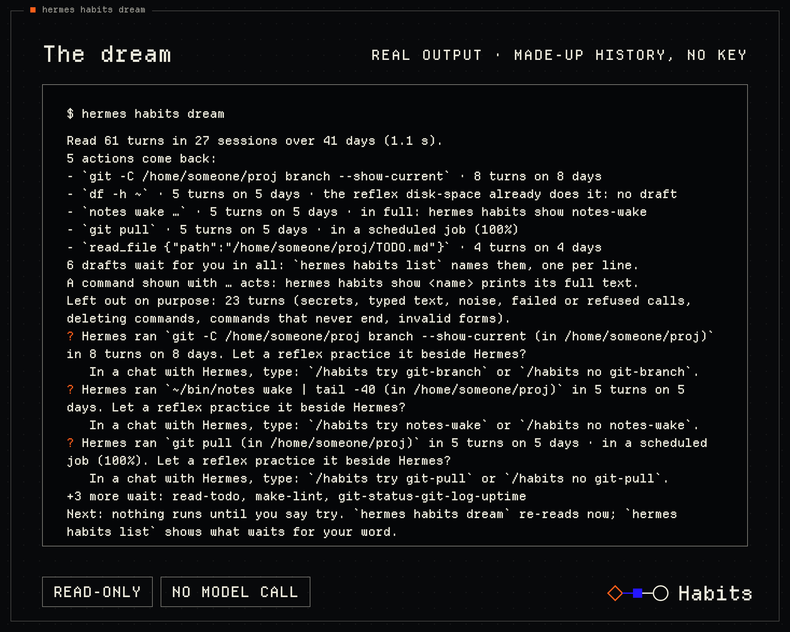
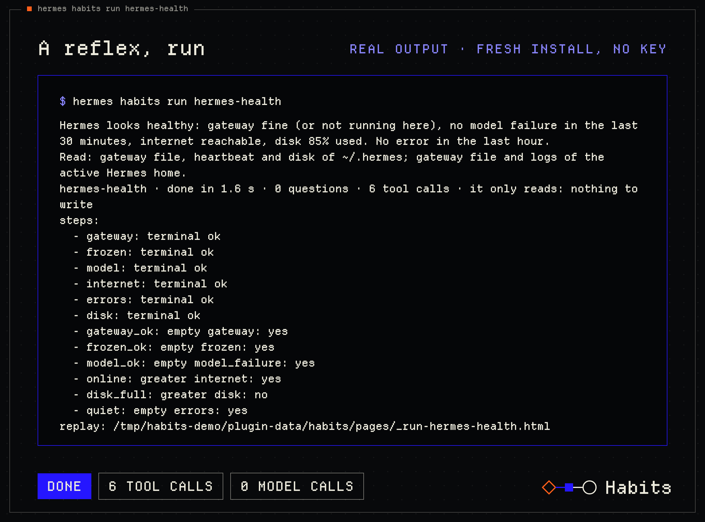
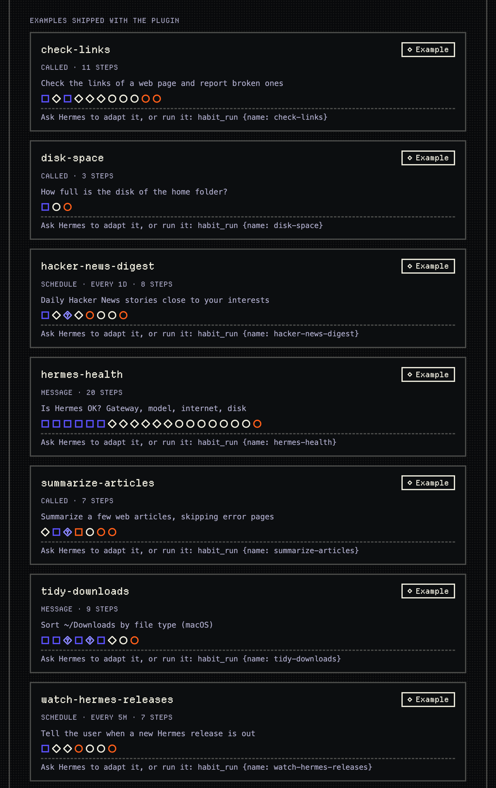

# Habits: reflexes for Hermes

Habits gives Hermes reflexes. A reflex is a pattern Hermes repeats (tool calls, small decisions, steps of a reply) grouped into one small file of steps. Hermes runs it as written, with no model turn between the steps (the advanced `llm` step is the one exception), and gets back only what the reflex could not finish.

```text
hermes-health, the shipped reflex behind "Is Hermes OK?"

do gateway → do frozen → do model → do internet → do errors → do disk         six reads, each a real command
  → check gateway_ok → frozen_ok → model_ok → online → disk_full → quiet     six checks, no model
  → done: a verdict ("looks healthy" or "needs attention")     or     handed back to Hermes with what is left
```

| "Is Hermes OK?" in real chats | Time | Calls to Hermes's model |
| --- | --- | --- |
| Hermes works it out | 41 s | 4 to 10 |
| Hermes calls the reflex by name (no yes, no key needed) | 5 to 8 s | 2 |
| The reflex answers before Hermes's model (your yes, a decision-model key, after its first checked runs) | 2.7 s | 0 |

Rows 1 and 3 are medians of real one-turn chats (6 for Hermes alone, 10 timed turns for the reflex); row 2 is the range seen when Hermes called it by name. One user, one Mac, one cheap model, 10 November. After your yes the reflex is checked first: in a chat where Hermes's model has just answered, Hermes still answers such messages itself, with the reflex run beside it, until 3 answers agree, then about 1 time in 10 (17 to 59 s on those turns, simulated days of 11 November): [how it was measured](docs/BENCHMARKS.md).

**The decision model.** Where a step has to decide (does this message ask for this reflex? is this story close to my interests?), it puts a closed question with named choices to a small typed decision model: Jev, by TypeSafe. Without a Jev key the same questions go to your own Hermes model, slower. What is sent is listed in [SAFETY](docs/SAFETY.md).

**More than a skill or a script.** A skill, even one that ships a script, waits for the model to choose it and to read its output. A reflex can start on a message you said yes to, before Hermes's model is called; it branches on rules and closed questions; and when it cannot finish, it hands the rest back.

## Try it in 2 minutes, without a key

```bash
hermes plugins install emiwltz/hermes-habits
hermes plugins enable habits
hermes habits run hermes-health   # the reflex above: six checks, a verdict, no model
hermes habits dream               # what does YOUR Hermes do again and again? never writes your Hermes history, calls no model
```


**Where reflexes come from.** Ask Hermes to "make it a habit", or let the **dream** find them: it re-reads the history Hermes already keeps, on your machine, with no model call, and proposes a reflex for what your Hermes does again and again. A draft practices beside Hermes first; it acts on its own only after your yes.

**Hermes thinks. A reflex acts. The dream learns.**



`hermes habits dream` prints the actions that came back in your own Hermes history. It writes nothing there; its own
notes (the drafts it proposes) go in the plugin's ledger, `habits.db`. With `--days N` or `--home FOLDER` it is a
look: nothing is saved at all. On a fresh install (`learning: suggest`) nothing is run or practiced for you until you
say try. The start of its output on a made-up history (`tests/e2e/make_history.py`, the project's folder written
`/home/someone/proj`), final build of 11 November (1.1 s by its own count, the same run as the picture):

```text
Read 61 turns in 27 sessions over 41 days (1.1 s).
5 actions come back:
- `git -C /home/someone/proj branch --show-current` · 8 turns on 8 days
- `df -h ~` · 5 turns on 5 days · the reflex disk-space already does it: no draft
- `notes wake …` · 5 turns on 5 days · in full: hermes habits show notes-wake
- `git pull` · 5 turns on 5 days · in a scheduled job (100%)
- `read_file {"path":"/home/someone/proj/TODO.md"}` · 4 turns on 4 days
6 drafts wait for you in all: `hermes habits list` names them, one per line.
A command shown with … acts: hermes habits show <name> prints its full text.
Left out on purpose: 23 turns (secrets, typed text, noise, failed or refused calls, deleting commands, commands that never end, invalid forms).
```

A moment ("in a scheduled job", "after the skill X", "first gesture of a session", "closes the work") is shown when
it held in at least half of the action's turns, two at most; the percentage is that share. "First gesture" and "closes
the work" count only turns that hold other calls: in a turn of one call they would say nothing. With little history
the dream says what is missing. `hermes habits list` names every draft with what it waits for;
`hermes habits show <draft>` prints its reflex whole; `hermes habits run <draft>` test-runs it: a local read runs,
anything else (a web call included) is only planned, and the line says why.

`hermes habits run hermes-health` runs the shipped reflex of the first screen: six reads and six checks (20 steps in the
file; a run walks 11 or 12), a verdict (1.6 to 1.8 s by its own count, 2.9 to 3.5 s for the whole command, three runs on
11 November), and a `replay:` line with the path of a page that shows every step with its time. None of the six reads writes; one sends a single
HEAD request to github.com, and three read `~/.hermes` (the gateway file and the disk), whatever `HERMES_HOME` says.
Then start a new Hermes session and ask **"Is Hermes OK?"**: Hermes finds `hermes-health` in its list of reflexes,
calls it by name and answers with the verdict.

**To reach the automatic path** (the reflex answers before Hermes's model, the last row of the table above):

1. Run `hermes habits yes hermes-health`. The shipped reflex is called by name and never acts alone; this prints the
   folder to copy.
2. Copy that folder into your skills folder under another name (`cp -r <the printed folder> ~/.hermes/skills/my-hermes-health`)
   and change the `name:` line at the top of its `SKILL.md` to the same name, or the copy keeps the old name.
3. Run `hermes habits yes my-hermes-health`. It prints `✅ my-hermes-health answers on its own now. I check behind it until 3 runs agree, then 1 time in 10.` A checked run is answered by Hermes's model (slow) while the reflex runs beside it; when Hermes's model has not answered in the last 10 minutes of that process, the reflex answers at once.
4. Set a decision-model key (`TYPESAFE_API_KEY`) for the 2.7 s path; without it Hermes's own model decides the start (6.8 s in one measured run).

Steps 1 to 3 were done on 11 November in a throwaway Hermes home with no key; `hermes habits list` then showed
`1 automatic · 0 learning`. That home was not timed: the speed figures come from installs with the key set.



## How a habit is born

Learning to drive, you think about everything: the pedal, the wheel, the mirror. A year later you just drive. Hermes
still asks its model what to do at every gesture, even on the hundredth "Is Hermes OK?". A reflex moves that down.

A **habit** is a reflex with its story: **learning** (it runs as a test beside Hermes), then **automatic** (it acts,
after your yes), or **resting**. A reflex the dream is still testing is a **draft**.

```text
 Hermes works ──▶ the dream re-reads ──▶ a reflex practices ──▶ your yes ──▶ it acts
 (nothing changes     what comes back:      beside Hermes:           in /habits   and hands back
  for Hermes)          3 turns, 2 days       same result?                          when unsure
```

- **What comes back:** the same action in at least 3 turns on at least 2 different days of the last 60. Several
  calls in one turn count once. A call that failed, was blocked or was refused does not count.
- **What may become a draft:** a terminal command, a file read (`read_file`, `search_files`), and a call of another
  tool (an MCP tool, `browser_navigate`) whose arguments are all plain: numbers, single words, paths, URLs without a
  query.
- **What it leaves out:** a secrets file, a deleting command, a command that never ends (`tail -f`, a dev server),
  code Hermes ran (`execute_code`, a sub-agent), a failed call, a call that carries typed text (a message sent, a
  file written, a search of several words, a click or a typed field in a browser), and an action not seen for 30 days. This is a
  check of words and shapes, not a proof: a secret spelled in a way it does not know can pass (a one-word password in
  a plain argument, for one), and it errs on the careful side (a file only named `tokens.md`, an option ending in
  `-file` or `-key`, a quoted word that mixes 8 or more letters and digits are left out too). It keeps counts and
  verdicts, never an output. In its report, an action that acts is shown without its arguments unless they are plain.
- **Practice (after your "try", or from the start with `learning: practice`):** the plugin re-runs by itself, in the
  background, the local read commands Hermes just ran, in the same folder, at most once per draft per 10 minutes, three
  drafts at a time. Its result is compared in memory with Hermes's. Anything else (an act, the web, an unknown
  program) is only planned: a match then means "Hermes did this exact action again", nothing more. With the default
  `learning: suggest`, nothing is run or practiced for you until you say try (`/habits try <name>`).
- **Ready:** after 3 matches (2 with caution `relaxed`, 5 with `strict`). A card in `/habits` shows the exact
  command and its folder; nothing runs for real before your yes, and your yes never overwrites a habit of yours.
- **Three kinds of proposal:** create a reflex, change one (its action came back in another form), put one to rest
  (30 days unused). Two actions, or two dream-made reflexes Hermes calls by name, that come together in 3 turns on
  2 days become one reflex of up to 4 steps. At most 3 decisions are shown at a time and one line of news a day. A
  no holds for 30 days.
- **Where it acts:** a reflex made this way starts when Hermes calls it by name; after your yes it runs for real.

You can also tell Hermes "make it a habit": it writes the reflex itself (the `writing-habits` skill), tests it with
`habit_run {dry: true}` and saves it with `habit_save`.

## The numbers, and what they do not say

The table on the first screen is the headline: Hermes alone, 6 real chats of 10 November, 10.8 to 70 s (median 41 s,
4 to 10 model calls); the reflex, 10 timed turns of 2.4 to 2.8 s (median 2.7 s), and 15 chats of 15 answered with no
call to Hermes's model; builds of 10 November (v0.1), one user, one Mac, one cheap model. On the later build of
11 November the whole command took 3.5 s (5 of 5, 3.3 to 3.9 s) and 27 to 48 s with Habits switched off (not pure
Hermes: the model still loaded the skill and tried the reflex first; 8 to 14 model calls); the fixes made after that
trial were tried only in the simulated days below (build aad995e); what changed after that build is covered by tests only. Simulated days of use, 11 November (229 turns, 0.45 $): 0 guard refusals
in 68 turns of ordinary work; with nothing to do the plugin cost 43 model calls against 42 and 114.2 s against 114.0 s;
"make it a habit" saved 4 of 4 in 49 to 97 s. What the figures are, and are not: [BENCHMARKS](docs/BENCHMARKS.md).

What the dream finds is small gestures, not whole tasks. On one user's real 60 days (983 turns): 26 actions came back
at least 3 times on 2 days; the most frequent one came back in 71 turns on 15 days. Model replies that held only one
of those repeated calls: 96 of 4,087, about 2 %. A reflex of one step alone saves little; the gain comes when steps
are assembled into a task, like the six checks of `hermes-health`.

## A reflex, in full

This is `examples/disk-space`, comments removed: one step, a read. `end` is done; `wake` is handed back.

```yaml
spec: habits/0.1
start: disk
fallback: help
limits: {seconds: 15, tools: 1, questions: 0, llm: 0}
nodes:
  disk:
    do: terminal
    read: true
    args: {command: "df -h ~ || true"}
    as: disk
    next: done
  done:
    end: "Disk space of the home folder:\n{disk}"
  help:
    wake: "The disk check stopped before the end (the report says where). Run df -h ~ by hand and answer with the free space."
```

The steps: `do` acts, `ask` decides, `check` tests a rule, `use` calls another reflex, `end` is done, `wake` hands back
(`llm` also exists, for advanced use). Four modifiers (`as each where with`), 20 steps at most, no loops. The file keeps
the names `nodes` and `trigger`.



The shipped `watch-hermes-releases` is one read and two checks that hand back only
when a new Hermes release appears. A reflex **starts** in four ways: **called** (Hermes calls it by name), **message**
(a message asks for it; the decision model recognizes it), **schedule** (`trigger: {every: 30m}`), **skill**
(`trigger: skill`: when Hermes loads the reflex's own skill, the reflex runs and its reply is added to the skill text;
no inputs, no `ask` or `llm` step). The start on a loaded skill worked 2 of 2 on a real Hermes (11 November).
A step can use any Hermes tool (a command, a file, the web, an MCP tool, a message, a scheduled job, a skill). For
MCP, a test shows that validation accepts the step and a live run dispatches it; a real MCP server: not tried.

## You decide

| In a chat | What it does |
| --- | --- |
| `/habits` · `/habits <name>` | your habits and their states, then the decisions waiting; one habit with its last 5 runs |
| `/habits yes <name>` · `/habits no <name>` | yes lets it act on its own; no: not proposed again for 30 days |
| `/habits try <name>` · `/habits rest <name>` | keep it practicing, or bring it back · put it to rest |
| `/habits wrong` | the reflex that just answered here got it wrong: it goes back to learning |
| `/habits undo` · `pause` · `resume` · `dream` · `view [name]` | undo your last change (24 h) · pause every start from a message or a schedule · re-read the history now (never says yes) · the gallery |

| In a terminal | What it does |
| --- | --- |
| `hermes habits dream [--days N] [--home FOLDER] [--json]` | the same dream; with `--days` or `--home` (another Hermes home, read only) it is a look and saves nothing |
| `hermes habits run <name or file> [--input k=v] [--live]` | run a reflex or a draft here without the model, as a test unless `--live`; prints a `replay:` page |
| `hermes habits list` · `show <name>` · `view [<name>]` | what `list` prints: every habit with its state (learning, automatic, resting) and every draft by name with what it waits for · a reflex's or a draft's steps, whole · the gallery or one diagram |
| `hermes habits yes` · `rest` · `pause` · `resume` · `undo` | the same decisions; a reflex Hermes or the dream made takes only a yes typed in a chat |
| `hermes habits check <file>` · `cleanup` | validate a reflex file · remove every cron job and every file of `$HERMES_HOME/scripts` whose name starts with `habits-` (before you uninstall) |

Seven settings and the Jev key. Change one with `hermes config set plugins.entries.habits.settings.<name> <value>`
(for example `...settings.language fr`):

| Setting | Values (default first) | What it changes |
| --- | --- | --- |
| `learning` | `suggest`, `practice`, `auto`, `off` | `off`: nothing is spotted or practiced. `suggest` (the default): the dream only reads and shows; nothing is run, and a draft practices after you say try. `practice`: the plugin re-runs local reads by itself, up to 3 drafts at a time, and waits for your yes. `auto`: every dream-made reflex becomes automatic as soon as it is ready, with no question (reading or acting, one step or several). A reflex that holds a deleting command, or a command Hermes would ask approval for, always waits for your yes, whatever this setting says. A message or schedule habit that meets its thresholds also becomes automatic, without the permissions of a yes |
| `caution` | `normal`, `relaxed`, `strict` | how much proof a habit needs before it is ready and before it rests |
| `dream` | `daily`, `manual` | `daily`: the dream re-reads after a reply, once a day at most. `manual`: only when you ask |
| `decision_model` | `auto`, `jev`, `hermes` | who answers `ask` steps. `auto`: Jev when its key is set, else Hermes's model. `jev`: Jev first, then Hermes's model. `hermes`: Hermes's model only |
| `permissions` | `hermes`, `strict` | see Safety |
| `model_text` | `quoted`, `never` | see Safety |
| `language` | `en`, `fr` | the language of the plugin's own lines |
| Jev key | `TYPESAFE_API_KEY` | optional: fast decisions with Jev (TypeSafe) |

## Safety at a glance

- **A habit acts on its own only after your yes in `/habits`, with two exceptions.** (1) A message habit that only
  reads and that you asked for in so many words ("make this a habit") starts automatic at once. (2) With
  `learning: auto`, the thresholds alone make a message or schedule habit automatic, write steps included, and every
  ready reflex the dream made, except one with a deleting or approval-asking command. Neither gets the extra
  permissions of a yes. While a habit practices, reads run and everything else is only planned.
- **What runs without you:** with `learning: practice` (a setting you choose), the plugin re-runs by itself, in the
  background, local read commands Hermes just ran, in the same folder, at most once per draft per 10 minutes, three
  drafts at a time. With the default `suggest`, nothing is run for you until you say try.
- **`permissions: hermes`** (default): a habit with your yes given in a chat has, inside a Hermes turn, the rights
  Hermes's model has in that turn. A command Hermes flags goes to Hermes's own approval rules: they ask in a chat;
  when nobody is there (cron, `-q`) they apply the mode you set in Hermes for that context
  (`approvals.cron_mode`, `approvals.single_query_mode`, `approvals.unattended_mode`), which refuses by default;
  if you set a mode to approve, or turned approvals off, nothing is asked. Their hard floor holds. Deleting commands
  written in the reflex are allowed the same way, and the yes card shows them. Hermes does not ask about
  everything: on Hermes 0.23, a plain `rm file.txt` is not flagged, a recursive delete and `find` with `-delete` are.
  **`strict`:** the plugin refuses both beforehand. Outside a turn (`hermes habits run --live`, a schedule) it
  refuses them in both modes. A one-off reflex the model writes acts for real unless `dry: true`. It never deletes
  and never runs a command Hermes flags.
- **`model_text: quoted`** (default): text a model wrote may enter a command as one quoted piece, and only where a
  short list of programs take it as data; it is refused as the program, as the script of `sed`, `awk` or `jq`, or as
  code. `never`: it never enters a command.
- **What leaves the machine.** Decision questions go to TypeSafe Jev only with your `TYPESAFE_API_KEY`, else to
  your Hermes model. Once one message habit exists, every message of 2,000 characters or less that is not a slash
  command is sent there, with the names, descriptions and up to 3 paths or URL hosts of your message habits, to
  decide whether it starts one. The caps (8,000 characters of state, 50 questions of 8,000 characters) are per
  request, and a run may send several. When Hermes saves a habit, your last message (8,000 characters at most) is
  sent once to ask whether you asked for it. The plugin also calls your own Hermes model, whatever `decision_model`
  says: one check of a learning message habit's answer against Hermes's, and each `llm` step. No telemetry.
- **What a fresh install adds.** To every session, a section of at most 2,400 characters (about 1,750 on a fresh
  install) that lists your reflexes and the four shipped examples that only read and start on no schedule; Hermes may call any shipped example by name without a
  yes, and it then runs for real (`tidy-downloads` moves files in `~/Downloads`). The shipped `hermes-health` sends
  one HEAD request to github.com and reads the gateway file and disk of `~/.hermes`. The other examples reach the web
  only when called: api.github.com, hn.algolia.com, the pages you name.
- **The guard** reads only the model's calls that visibly concern the plugin's world (the `hermes` program and
  `hermes habits`, the plugin's data and code folders, a habit's files, Hermes's settings and history, `HABITS_OFF`).
  In such a call it refuses what it cannot read; any other call passes untouched. It stays on when Habits is switched
  off, and it lets the model read the plugin's code (also through a link to a working copy), not edit it. It is a
  text check. Known limits, named in SAFETY.md: a target hidden from reading (a path built at run time inside code,
  an encoded script, text decoded and piped into a shell) and a row forged in the ledger file.
- **What is stored.** Under `$HERMES_HOME/plugin-data/habits/`, unencrypted: runs and traces (tool outputs included),
  the request text of message habits (cut to 300 characters, kept 14 days), and while a message habit learns, the
  arguments of Hermes's own tool calls of that turn; the ledger file is created readable by you only (`0600`), its
  folder with your account's default permissions.
  `hermes habits cleanup` removes every cron job and script whose name starts with `habits-`: run it before you
  uninstall. More: [docs/SAFETY.md](docs/SAFETY.md).

## Not the same thing as

- `habit` (learns which commands you approve) and `reflexes` (starts a turn when a file or a USB key arrives):
  unrelated plugins with a close name.
- `kata` learns the multi-step tool routines your agent repeats and, after your approval, compiles each into one tool
  that runs its steps without model round-trips. The nearest neighbour. Its routines are linear (its entry: "Branching
  on a result stays with the agent"); a reflex branches on rules and closed questions, can answer a message before
  Hermes's model is called, and hands back what is left.
- `hermes-workflows`: its steps are agent turns, each a child Hermes chat, with waits for a person or a command between them. In a reflex the steps
  act and the model gets back only what is left (the advanced `llm` step apart).
- `hermes-dreaming`: it dreams about what Hermes remembers. Habits dreams about what Hermes does.

## Limits

- **One user, one decision model.** The tasks and phrases come from one person's sessions; every measured decision
  ran on Jev. With Hermes's model deciding, the numbers do not apply.
- **Small samples.** Waves of 7 to 9 November: 80.3 s alone, from 2 runs; campaign of 10 November: 41 s, from 6.
  New wordings are often missed: 14 of 20 recognized (held-out set); 5 of 10 wordings of "Is Hermes OK?" started the
  reflex in the simulated days of 11 November.
- **Day one gives a list, not a saving.** What the dream gives on day one is a list of repeated gestures and
  proposals. The saving comes once reflexes are assembled into a task or made by asking Hermes ("make it a habit").
  The dream proposes fixed actions only (no inputs yet), and few real actions are local reads, so most practice counts
  "it came back", not "same result".
- **A reflex of one step shows no gain.** In the trial of 11 November the model called a dream-made one-step reflex
  in 1 plain request of 5 (3 of 3 when the request named it), and the turn cost 2 model calls with or without it.
- **The build of 11 November** (commit fe9579c) was measured in one trial of 75 real turns
  ([BENCHMARKS](docs/BENCHMARKS.md)); the fixes made after it were tried in the simulated days (229 turns, build aad995e), what came after that build by tests only. The
  start on a loaded skill worked 2 of 2 on a real Hermes. A real MCP server: not tried.
- **Private imports.** Six, each with a fallback (SAFETY.md, section 10); `hermes plugins validate` warns of them.
- **Platforms.** Measured on a Mac, plus one watch and two trials on a Raspberry Pi (Hermes 0.22.5, Linux arm64:
  the install, the shipped reflexes and the dream on a real history work at commit e2292b8, and the whole suite passed there
  at the last code commit, ab58950: 4,962 passed, 1 skipped). Other Linux is covered by tests only.

## Roadmap

Decision providers other than Jev, and a local decision model (no key, nothing leaves the machine). Read-only MCP steps;
reflexes with inputs, born from the dream; a page for the dream; starts on a session opening, a reaction or a kanban event.

## Links

[SPEC.md](SPEC.md) · [docs/REFERENCE.md](docs/REFERENCE.md) · [docs/SAFETY.md](docs/SAFETY.md) · [docs/BENCHMARKS.md](docs/BENCHMARKS.md) · [MIT](LICENSE)
