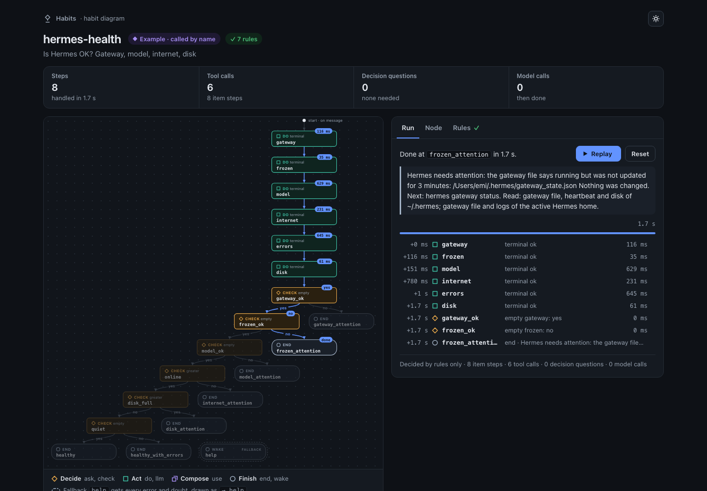

# Habits: reflexes for Hermes

If tools are the model's limbs, habits are its reflexes.
Hermes thinks it through once; after that, it's a reflex.

Habits splits an agent's work into two levels that hand work to each other. Hermes thinks: slow, general, costly.
A habit acts: fast, narrow, nearly free, a small fixed graph that runs without the model. A habit can step in
before the model thinks, in the middle of a task or while Hermes sleeps, and it always comes back: done, or
handed back with what is left. Two words: a **habit** is what Hermes has learned, with its state (learning,
automatic, resting); its **reflex** is the part that runs, a small graph of gates. Its gates are tools, rules and
typed decisions (yes or no, a choice, a score) answered by a small, fast decision model.

A habit can be small or large. The smallest one shipped, `watch-hermes-releases`, is one command and two rules:
look for a new release, wake Hermes only if there is one. The largest, `hermes-health`, is six reads and six rules.
And a habit can act, not only read: `tidy-downloads` asks a typed question about each file, then moves it, once you
have said yes. Small or large, it is the same thing: a graph you can read, that Hermes writes, checks, repairs and
rests.

Ask Hermes "Is Hermes OK?". Alone, it answers in about **40 s**. As an automatic reflex, the same check takes
about **2.5 s**, with **no model call**, and it still answers when the model is the broken part. In one pair of
real chats timed end to end, start-up included: 32.8 s and 8 model calls alone, 3.6 s and no call to Hermes's model
with the habit.

*Measured on v0.1 in real chats: 6 turns alone (11 to 70 s), 15 as a reflex (15 of 15 without the model). One
user's Mac, one cheap model: run the three commands below to check for yourself. Method and caveats:
[docs/BENCHMARKS.md](docs/BENCHMARKS.md).*



*The page the plugin writes for a run, here one run of the shipped `hermes-health` reflex on a fresh install with
no key: every step with its time, the path it took, and how it ended. Captured unedited. The 1.7 s is that run
alone; the 2.5 s above is a whole turn in a real chat.*

## Try it in 2 minutes, without a key

```bash
hermes plugins install emiwltz/hermes-habits
hermes plugins enable habits
hermes habits run hermes-health
```

The last command runs the shipped `hermes-health` reflex: six read-only checks (gateway, a frozen gateway, model
failures, internet, frequent errors, disk), then a verdict (about 3 s for the whole command), and a
`replay: <path>` line: open that page to see each step with its time, and how it ended.

Now in a chat: start a new Hermes session and ask **"Is Hermes OK?"**. Hermes finds `hermes-health` in its
list of reflexes, calls it by name, gets back `done: true`, and answers with the verdict.

## The relay

Hermes thinks: slow, general, costly. A reflex does one known task: fast, narrow, nearly free. Between them, a baton:

```text
   Hermes thinks ──── habit_run {name, inputs} ────▶ reflex acts (tools, typed questions, checks)
        ▲                                                   │
        │   done: true   "Done: use this result as it is." │
        └── done: false   left: [what is left]  ◀───────────┘
                          "Handed back (why): do only what is left."
```

**The one rule: a reflex always comes back, done, or handed back with what is left.**
When it is unsure, it never guesses. A step that fails, a budget that runs out, an answer the decision model is unsure
of: the reflex stops and lists what is left. Hermes does only that.

A reflex is more than a script. Its `ask` nodes put typed questions (yes/no, a choice, a score) to a fast
decision model; its `check` nodes compare values; both branch. It decides, and hands back when unsure.

## Six moments in a turn

| Moment | What you say, or what happens | What the reflex does |
| --- | --- | --- |
| Before the model thinks | a message matches an automatic reflex | runs before Hermes's turn; Hermes confirms or finishes |
| Mid-task, by name | "Publish my notes and check the links" | Hermes publishes, then calls `check-links` |
| Several at once | "Is Hermes OK, and are my links fine?" | `habit_run {habits: [...]}`: 2 to 8, in order |
| Many small decisions | "Sort these 30 notes into task, idea, reference" | a one-off graph, one typed question per item |
| Closing routine | Hermes finishes work that has a closing reflex | it calls that reflex (check, sync, tidy) last |
| On a schedule | `trigger: {every: 30m}` | a cron check, scheduled at save; wakes Hermes when it hands back or, while learning, when it would write (Hermes then does the task) |

## Measured in real chats on v0.1

The right reflex in 19 requests of 20, in French and English; none in 6 traps of 6; one grouped call for two or
three reflexes. Mid-task ("find a note and, while you are at it, check your health"): 3 model calls, 12 s. The
user's own status habit, called in the middle of a summary: 3 calls, 9 s; grouped with the health check for a
"morning check": 2 calls, 9.5 s. [Details](docs/BENCHMARKS.md#the-campaign-of-10-november-on-v01)

## Results on real tasks

Eight task families from one user's Hermes sessions, replayed as plain asks, traps, outages and doubts. Five:

| Task | Right | Faster than Hermes alone | Model calls avoided |
| --- | --- | --- | --- |
| Hermes health check | 44/48 trigger cases, 13/13 others | 34.5x | 100% |
| Status of agents on another machine | 39/39 trigger cases, 10/10 others | 16.5x | 100% |
| Watch a notes folder, wake only for what needs an answer | 30/30 | 5.3x over a modelled night | 95% |
| Render, publish and check a dashboard | 16/16 | 5.0x | 84% |
| Save a web page as a note | 39/41 | 2.3x and 3.3x | 70% and 77% |

These waves ran before v0.1, with 1 or 2 baseline runs per task (the health check above: 6). The misses
were trigger misses (Hermes answered instead) and two runs over a 30 s limit: [docs/BENCHMARKS.md](docs/BENCHMARKS.md).

## What changes on every repeat

| Instead of | On every repeat | With a reflex |
| --- | --- | --- |
| A prompt | the model reasons through every step again | the steps run without it; it reads one reply |
| A skill | the model reads it and makes each call itself | the skill keeps the slow way; the reflex is the fast one |
| A cron job | a blind script runs, or the agent wakes every time | the check acts, and wakes Hermes only for what is left |
| A recorded routine | a fixed line of steps; branches go back to the agent | questions and checks branch inside; doubts hand back |

## Safety at a glance

- It refuses any command that names a deleting program (`rm`, `rmdir`, `shred`, `unlink`, `dd`, `find -delete`).
  The check reads the command's text, not what it does: [docs/SAFETY.md](docs/SAFETY.md) lists what it does not see.
- It never waits for an approval: a command Hermes would flag fails, and the reflex hands back.
  Text a model wrote never enters a terminal command.
- Acting uninvited is earned: a habit with a message or schedule door practises dry beside Hermes (learning), and
  with the default `promote: ask` acts alone only after your yes in `/habits` (except a request habit that only
  reads and that you asked to keep, which starts automatic with spot checks). A file copied in by hand also waits.
  Before your yes (or 3 agreeing checks), each check compares the habit with Hermes's own answer; after, it only
  asks whether the habit's answer is wrong.
- Saving a schedule habit writes `$HERMES_HOME/scripts/habits-<name>.sh` and a Hermes cron job at once. A learning
  watch wakes Hermes each time it would act, and Hermes does the task itself, unattended (paid model turns).
  Run `hermes habits cleanup` before you uninstall: it removes every such job and script.
- Runs and traces, tool outputs included, are stored unencrypted under `$HERMES_HOME/plugin-data/habits/`.
- The model cannot change a state, approve itself, or edit a habit's files: only your chat or your terminal can.
- One outside connection of its own: decision questions to TypeSafe or Cloudflare, only with that model's key. No telemetry.

## The decision model

Typed decisions (yes or no, a choice, a score) are the heart of a habit: a fast decision model answers each
question at a gate, and the graph follows the answer. Two models today, chosen in the plugin's settings
(`backend`): **Jev by TypeSafe** (`TYPESAFE_API_KEY`) and **Clef by Cloudflare** (`CLOUDFLARE_API_TOKEN` and
`CLOUDFLARE_ACCOUNT_ID`, model `clef_model`), set in Hermes's environment file or in the settings. `auto` asks Jev
when its key is set, else Clef when its token and account are set, then your Hermes model. **Without any key**,
everything runs (the examples, habits called by name, `habit_save`, dry runs, schedules) and reflexes without
questions, like `hermes-health`, work fully; typed questions go to your Hermes model, slower, and those runs do not
count toward graduation: it rates its own confidence.

Install as in [Try it](#try-it-in-2-minutes-without-a-key), then start a new Hermes session (restart the gateway
too). Requires Hermes 0.22.5 or later.

## One short habit

A habit is a skill folder: `SKILL.md` (the slow way) and its reflex, `assets/reflex.yml` (the fast way).
This is `examples/check-links`, comments removed. A broken link is what it is there to find: it ends done with
each link marked ok, blocked (the site refused a script) or broken, and hands back only when the page did not load
or the check stopped:

```yaml
spec: habits/0.1
inputs: [page]
start: links
fallback: help
limits: {seconds: 400}
nodes:
  links:
    do: terminal
    read: true
    args:
      command: >-
        curl -sL --max-time 20 {page}
        | tr '\n\t' '  ' | grep -oiE '<a [^>]*href="?https?://[^" >]+' | sed -E 's/^.*[hH][rR][eE][fF]="?(https?:)/\1/' | sort -u | head -n 30
      timeout: 30
    as: links
    next: found
  found: {check: {empty: links}, then: {yes: nolinks, no: probe}}
  probe:
    do: terminal
    read: true
    each: links
    args:
      command: >-
        curl -sL -r 0-0 -o /dev/null -w '%{''http_code}' --max-time 10 {item}
        | awk '{''print ($1 ~ /^[23]/ ? "ok" : $1 == 416 ? "ok" : $1 ~ /^40[135]$/ ? "blocked" : $1 == 429 ? "blocked" : $1 == 999 ? "blocked" : "broken")}'
      timeout: 15
    as: status
    next: verdict
    error: help
  verdict: {check: {contains: [status, broken]}, then: {yes: some, no: maybe}}
  maybe:   {check: {contains: [status, blocked]}, then: {yes: careful, no: sure}}
  sure:    {check: {empty: doubts}, then: {yes: fine, no: some}}
  fine:    {end: "Every absolute link of {page} answers (links with a full http(s) address, 30 at most):\n{status}", with: [status]}
  careful: {end: "No broken link among the absolute links of {page} (links with a full http(s) address, 30 at most). Some sites refused an automated check (blocked: 401, 403, 405, 429 or 999 to a script, usually fine in a browser); each link:\n{status}", with: [status]}
  some:    {end: "Some absolute links of {page} are broken (links with a full http(s) address, 30 at most). Each link was fetched once with curl (one byte, 10 s limit): ok = 2xx, 3xx or 416; blocked = 401, 403, 405, 429 or 999, the site refused a script and the link usually works in a browser; broken = any other code (404, 410, 5xx) or no answer in 10 s. The broken ones need no second check. Each link:\n{status}", with: [status]}
  nolinks: {wake: "Found no http(s) link on {page}: the page did not load, has none, or builds its links with JavaScript. Try web_extract or a browser."}
  help:    {wake: "The link check of {page} stopped before the end: something went wrong, the report says what."}
```

Seven verbs (`ask check do llm use end wake`), four modifiers (`as each where with`), 20 nodes at most, no loops.
`end` is done; `wake` is handed back. Ask Hermes to "make it a habit": with the `writing-habits` skill it writes
the graph, tests it with `habit_run {dry: true}` (writes only planned), then saves it with `habit_save`.

## Commands

| In a chat | What it does |
| --- | --- |
| `/habits` | your reflexes, their states, and the ones waiting for your yes |
| `/habits wrong` | the reflex that just acted in this chat got it wrong: it goes back to learning |
| `/habits yes <name>` · `/habits pause` | your yes to a reflex that is ready · pause every reflex (`/habits resume`) |

| In a terminal | What it does |
| --- | --- |
| `hermes habits run <name>` | run a reflex here, without the model, dry unless `--live`; prints a `replay:` page |
| `hermes habits list` · `show <name>` · `view [<name>]` | states and recent runs, and for `show` the file and the steps of a reflex; the gallery or one diagram |
| `hermes habits check <file>` | validate a habit file |
| `hermes habits cleanup` | remove every schedule habit's cron job and script: run it before you uninstall |

## Limits

- **One user, one decision model.** The tasks and phrases come from one person's sessions; every measured
  decision ran on Jev. Clef follows Cloudflare's published schema and is covered by tests, not yet measured live.
  With your Hermes model deciding, the numbers do not apply.
- **Small samples.** Many cases ran 1 to 3 times; some speeds rest on 1 or 2 Hermes-alone baselines.
- **Two sets of numbers, two dates.** Waves (7-9 Nov, dev builds): 80.3 s alone, from 2 runs. Campaign (10 Nov, v0.1): about 40 s, from 6.
- **The campaign is small:** one install, one cheap model, each request once per pass, a judge written by the
  authors. Hermes alone took 11 to 70 s on one question, so ratios move.
- **New wordings are often missed:** 14 of 20 unseen requests recognised; the rest went back to Hermes.
- **Platforms.** Measured on a Mac, plus one watch on a Raspberry Pi; other Linux is covered by CI tests only.

## Roadmap

- **A local decision model.** Download a small open-weights model for typed decisions and answer on your own
  machine: no key, nothing leaves it.
- **More decision providers**, chosen in the same `backend` setting.
- **`check-links` follows a page's internal links** as well as its full addresses.
- **Habits in place of bare tools.** A habit that reads a note and acts on it, where today the model calls `read`
  and then decides: gates and commands chosen for the environment.

## Links

- [SPEC.md](SPEC.md): the `habits/0.1` format, the runner and the states
- [docs/REFERENCE.md](docs/REFERENCE.md): every verb, modifier and setting
- [docs/SAFETY.md](docs/SAFETY.md): what runs, what leaves the machine, what is refused
- [docs/BENCHMARKS.md](docs/BENCHMARKS.md): method, numbers, caveats
- MIT license. See [LICENSE](LICENSE).
